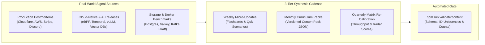

# Prototype Audit & Periodic Content Update Strategy

## 1. Comprehensive Prototype Audit & Review

### 1.1 Executive Evaluation Summary
The **Systems Design & Architecture Workbench** prototype is a local-first, zero-backend React 19 + TypeScript 5.7 + Vite 6 + Tailwind v4 single-page application designed for Senior, Staff, and Principal engineering preparation. An end-to-end audit of `src/types`, `src/context/StudyContext.tsx`, `src/data/*`, and `src/components/views/*` was performed to evaluate current strengths and prioritize structural upgrades for long-term study utility.

| Evaluation Dimension | Score | Current Prototype Strengths | Identified Gaps & Upgrade Targets |
| :--- | :---: | :--- | :--- |
| **1. Architecture & State Persistence** | **9.3 / 10** | Clean domain separation across 6 typed curriculum modules (`src/data/*.ts`), zero runtime backend dependencies, deterministic `localStorage` persistence (`sysdesign_study_state_v1`), JSON backup/restore, and global `Ctrl+K` fuzzy navigation. | Static bundle-only curriculum prevented users from authoring custom study notes as first-class searchable topics or installing periodic curriculum packs without rebuilding. |
| **2. Curriculum Depth & Production Realism** | **9.0 / 10** | High signal-to-noise ratio across 15 GoF patterns, 13 Distributed patterns, 8 Core Trade-offs, 6+ Framework Comparison Matrices, and 6+ End-to-End Case Studies with real production failure modes and anti-patterns. | Needed dedicated **2026 AI/LLM & Vector Search Infrastructure** coverage (HNSW vs IVFFlat vs DiskANN, RAG Hybrid Search & Reranking, LLM Token Bucket & KV-Cache routing). |
| **3. Interactive Simulators & Visual Aids** | **9.5 / 10** | Exceptional interactive laboratories: Circuit Breaker state machine, Token Bucket vs Sliding Window rate limiter, Consistent Hashing ring, CAP/PACELC partition toggle, Quorum `R+W>N` overlap calculator, and dynamic Back-of-the-Envelope capacity scaling across all Case Studies. | Simulators were coupled to individual views; adding a timed **45-Minute Mock Interview Simulator** with phase rubrics completes the bridge from passive exploration to timed execution. |
| **4. Active Recall & Diagnostic Assessment** | **8.8 / 10** | 5-Box Leitner spaced-repetition flashcards with keyboard shortcuts (`Space`, `1`–`4`), Diagnostic Architecture Quizzes with code/diagram hints, and embedded `10^x` Latency Numbers Reference Modal. | Needed integration of user-authored/pack-imported flashcards into the Leitner deck, a structured 4-phase Staff+ mock interview timer/self-grading rubric, and automated CLI content validation. |

---

### 1.2 Detailed Module Audit & Iteration Upgrades

1. **AI/LLM & Vector Search Infrastructure Coverage (`curriculum-upgrade-worker`)**
   - **Audit Finding**: Modern Staff+ system design interviews increasingly test high-dimensional vector indexing, hybrid lexical-semantic retrieval (`BM25 + Dense Vector + Reciprocal Rank Fusion`), and GPU/LLM inference gateway patterns (KV-cache prefix routing, TPM/RPM token-aware rate limiting, semantic caching).
   - **Resolution**: Added a 7th Framework Comparison Matrix (`vector-ai-stores`: pgvector HNSW vs Pinecone Serverless vs Qdrant vs Milvus vs Weaviate), a 7th Case Study (`enterprise-rag-search`: Enterprise RAG & Semantic Search Platform), and dedicated AI/Vector flashcards and diagnostic quiz questions.

2. **In-App Custom Content Authoring & Versioned JSON Curriculum Packs (`content-studio-worker`)**
   - **Audit Finding**: While `StudyContext.tsx` persisted mastery states, bookmarks, and per-item markdown notes, engineers could not author new standalone study topics or flashcards, nor could they install periodic curriculum updates without code changes.
   - **Resolution**: Extended `StudyContext` and `src/types/index.ts` with `CustomTopicItem`, `CustomFlashcardItem`, and `ContentPack` schemas, and introduced `ContentStudioView.tsx` featuring one-click installable **2026 Periodic Curriculum Packs**, custom topic/flashcard forms, and external JSON pack import/export.

3. **45-Minute Mock Interview Timer & Self-Assessment Rubric (`curriculum-upgrade-worker`)**
   - **Audit Finding**: Candidates often master theoretical trade-offs yet struggle with pacing during a 45-minute system design interview.
   - **Resolution**: Added a **Mock Interview Simulator** tab inside `ActiveRecallView.tsx` that pairs any Case Study with a 4-phase countdown timer (*Phase 1: Requirements & Scale Math [0–8m]*, *Phase 2: High-Level API & Data Model [8–20m]*, *Phase 3: Bottlenecks & Partitioning [20–35m]*, *Phase 4: Failure Modes & Deep Dives [35–45m]*) and an interactive Staff+ self-grading rubric persisted to `quizHistory`.

4. **Automated Schema & Curriculum Freshness Validation (`auditor-planner`)**
   - **Audit Finding**: As curriculum modules and periodic JSON packs grow, duplicate item IDs, missing required fields, or unbalanced difficulty distributions can silently degrade the study experience.
   - **Resolution**: Created `scripts/validate-content.mjs` (`npm run validate:content`) to statically inspect all `src/data/*.ts` exports, verify non-empty schemas, detect duplicate IDs across the entire workbench, and output a formatted **Curriculum Health & Freshness Report**.

---

## 2. Periodic Content Update & Evolution Strategy

Systems architecture evolves continuously—new storage engines, kernel primitives, distributed execution frameworks, and high-profile production outages reshape interview expectations every quarter. To keep the workbench evergreen without bloating the core UI, content updates follow a **3-Tier Periodic Update Cadence** delivered through both repository data modules (`src/data/*.ts`) and hot-installable `ContentPack` JSON bundles.



### 2.1 Tier 1: Weekly Micro-Updates (Postmortem-to-Active-Recall Loop)
- **Objective**: Convert real-world production incidents and engineering blog postmortems into active-recall flashcards and diagnostic quiz scenarios within 7 days of publication.
- **Primary Signal Feeds**:
  - *Cloudflare Blog*: Control-plane blast radius, BGP/Anycast routing anomalies, Pingora Rust proxy optimizations.
  - *AWS Builders' Library & Post-Event Summaries*: Cell-based architecture, shuffle sharding, bimodal behavior under grey failures, DynamoDB/Kinesis metadata lease storms.
  - *Stripe, Discord, Uber, Netflix Tech Blogs*: Idempotency ledger locking, Cassandra-to-ScyllaDB tail-latency migrations, NVMe tiered caching.
- **Artifact Output**:
  - 2–4 new `FlashcardItem` entries (focusing on root-cause mechanics and mitigation invariants).
  - 1–2 `QuizQuestionItem` entries categorized under `Anti-Pattern Diagnostic` or `Trade-Off Scenario`.
- **SLA & Review Time**: < 15 minutes per week; distributable as a lightweight JSON snippet or merged directly into `src/data/flashcardsQuizzes.ts`.

### 2.2 Tier 2: Monthly Curriculum Packs (Versioned `ContentPack` Releases)
- **Objective**: Expand architectural breadth with emerging distributed patterns, cloud-native infrastructure primitives, and end-to-end case studies without breaking existing user progress.
- **Target Domains**:
  - **AI & LLM Systems Infrastructure (`pack-2026-q1-ai`)**: Semantic Vector Caching, Token-Bucket Rate Limiting by TPM/RPM, GPU Dynamic Batching, vLLM PagedAttention, and Prefix-Aware KV Cache Routing.
  - **Modern Cloud-Native & Kernel Primitives (`pack-2026-q2-cloud`)**: eBPF Sidecarless Service Mesh (Cilium vs Envoy per-pod sidecars), Durable Execution Engines (Temporal/Restate deterministic replay vs step state machines), and Zero-Copy Tiered Kafka Object Storage (KIP-405).
  - **Real-World Outage Postmortems (`pack-2026-q3-outages`)**: Control-Plane vs Data-Plane fate sharing, Metastable Retry Storms, and Hot-Partition Request Coalescing.
- **Packaging Format (`ContentPack` Schema)**:
  ```json
  {
    "packId": "pack-2026-04-ebpf-durable",
    "title": "Pack 2026.04 — eBPF Networking & Durable Execution",
    "version": "1.0.0",
    "publishedAt": "2026-04-01",
    "description": "Monthly curriculum drop covering sidecarless eBPF meshes and deterministic workflow replay.",
    "topics": [
      {
        "id": "custom-topic-ebpf-mesh",
        "title": "eBPF Sidecarless Service Mesh Architecture",
        "category": "Cloud-Native Networking",
        "domain": "patterns",
        "difficulty": "Staff+",
        "summary": "Replaces per-pod TCP proxy sidecars with kernel-level socket redirection and per-node L7 proxies.",
        "tags": ["eBPF", "Cilium", "Service Mesh", "Tail Latency"],
        "keyTakeaways": [
          "Eliminates dual TCP loopback serialization per hop",
          "Reduces fleet memory footprint by 40-60% compared to per-pod Envoy sidecars"
        ],
        "architecturalNotes": "Use socket-level eBPF for mTLS/L4 policy and shared per-node proxies only when L7 HTTP/gRPC parsing is required.",
        "createdAt": "2026-04-01T00:00:00.000Z"
      }
    ],
    "flashcards": []
  }
  ```

### 2.3 Tier 3: Quarterly Benchmark & Matrix Re-Calibration
- **Objective**: Prevent architectural staleness in `src/data/frameworkMatrices.ts` and `src/data/systemTradeoffs.ts` as major open-source and managed systems ship structural upgrades.
- **Quarterly Audit Checklist**:
  1. **Relational & NewSQL Engines**: Re-verify PostgreSQL release notes (e.g., PG 17/18 vectored I/O, incremental backup, B-Tree multi-key optimizations, `pgvector` HNSW quantized indexing) and CockroachDB/Spanner multi-region read-lease latencies.
  2. **Event Streaming & Messaging Brokers**: Audit Kafka KRaft consensus operational simplicity scores (post-ZooKeeper removal), RabbitMQ Quorum Queues vs Streams throughput ceilings, and tiered storage cost profiles.
  3. **In-Memory & Cache Tiers**: Track Valkey / Redis 8+ multi-threaded I/O throughput benchmarks, Dragonfly shared-nothing architecture numbers, and Memcached slab-rebalancing improvements.
  4. **Hardware & Network Latency Constants**: Re-validate NVMe Gen5 random read latencies (~10–25 µs), intra-AZ 100GbE RDMA/TCP round-trips (~100–250 µs), and cross-continental fiber baselines inside `ActiveRecallView.tsx`.

---

## 3. Automated Pipeline & Agentic Automation Workflow

To make periodic updates repeatable and error-free, the workbench pairs deterministic CLI validation (`npm run validate:content`) with an automated agent workflow that can run via `/schedule` or GitHub Actions.

### 3.1 CLI Validation Gate (`npm run validate:content`)
Before any weekly micro-update, monthly JSON pack, or quarterly matrix calibration is committed, `scripts/validate-content.mjs` enforces four invariants:
1. **Non-Empty Module Exports**: Confirms `SOFTWARE_PATTERNS`, `DISTRIBUTED_PATTERNS`, `SYSTEM_TRADEOFFS`, `FRAMEWORK_MATRICES`, `CASE_STUDIES`, `FLASHCARDS`, and `QUIZ_QUESTIONS` are present and populated.
2. **Global & Local ID Uniqueness**: Extracts all item and contender `id` fields across `src/data/*.ts` and fails with a non-zero exit code if any collision is detected.
3. **Structural Completeness**: Verifies required fields (`id`, `title`/`front`/`scenarioTitle`, `difficulty`, `category`/`tags`) across every study item.
4. **Curriculum Health & Freshness Report**: Prints a summary table of item counts, difficulty distribution (`Fundamental` through `Staff+`), and minimum baseline thresholds.

### 3.2 Scheduled Agentic Content Synthesis Workflow (`/schedule` or CI Cron)
Engineers can automate periodic curriculum generation using a recurring scheduled agent task (`/schedule` every Monday at 09:00 or a monthly GitHub Actions workflow):

1. **Step 1 — Signal Ingestion**:
   - The scheduled agent queries curated engineering RSS/blog domains (Cloudflare, AWS Architecture, Discord, Uber, Stripe, Netflix, CNCF) for newly published postmortems or architecture deep-dives from the past 7–30 days.
2. **Step 2 — Structured Synthesis**:
   - For each high-signal article, the agent extracts:
     - *Core Bottleneck / Failure Mechanism* (e.g., lock contention, cascading retry storm, GC pause, split-brain quorum).
     - *Quantified Scale & Latency Metrics* (QPS, P99 latency, storage footprint).
     - *Architectural Mitigation & Trade-Off Accepted*.
   - The agent formats the output into either:
     - A standalone `ContentPack` JSON file (`docs/packs/pack-YYYY-MM.json`) for one-click import in **Content Studio & Updates**, or
     - Direct TypeScript entries appended to `src/data/flashcardsQuizzes.ts` / `src/data/distributedPatterns.ts`.
3. **Step 3 — Automated Verification**:
   - The agent executes:
     ```bash
     npm run validate:content
     npm run build
     ```
   - Any duplicate ID, missing attribute, or TypeScript compilation error halts publication until fixed.
4. **Step 4 — Review & Sync**:
   - Once validated, users either pull the updated repository or import the generated `.json` pack directly via **Content Studio -> External JSON Content Pack Importer**, preserving all existing `localStorage` mastery progress, Leitner flashcard boxes, and personal notes.
